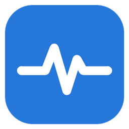
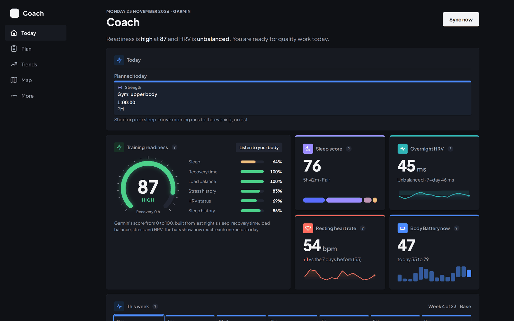
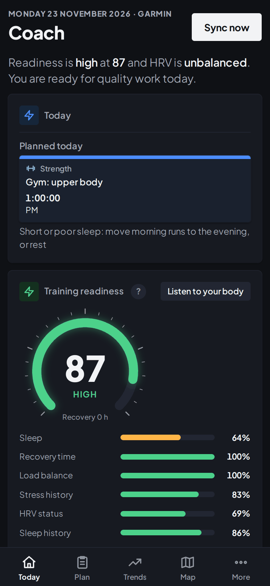
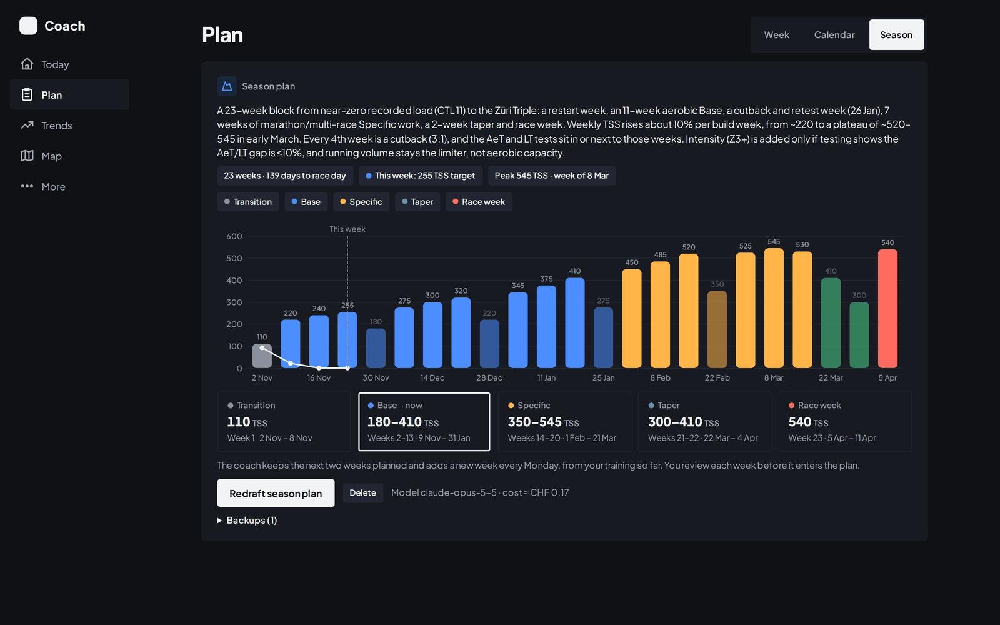
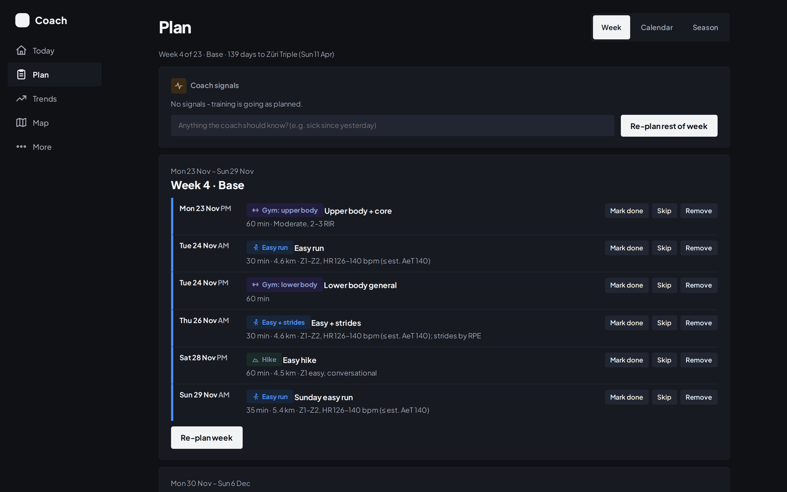
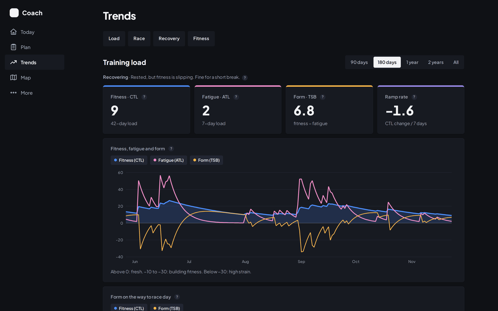
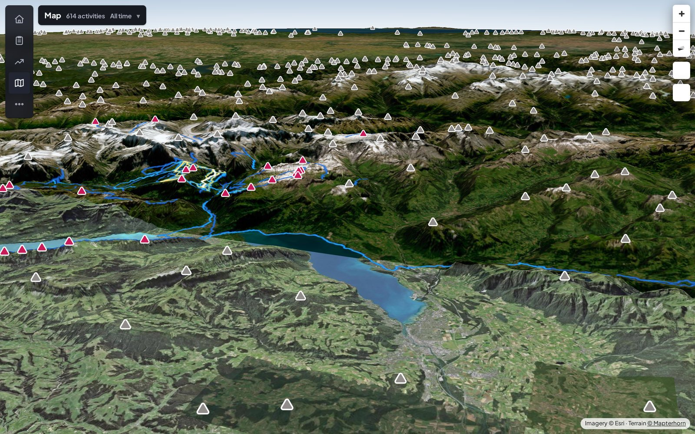
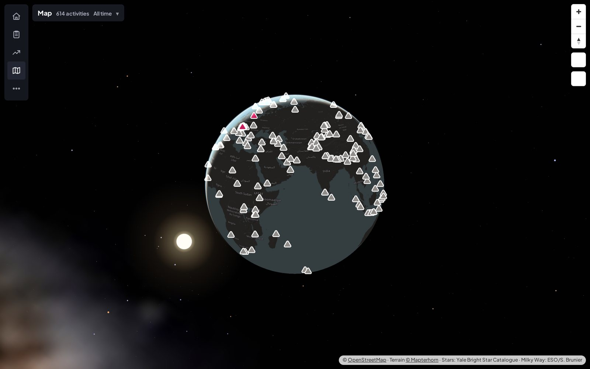
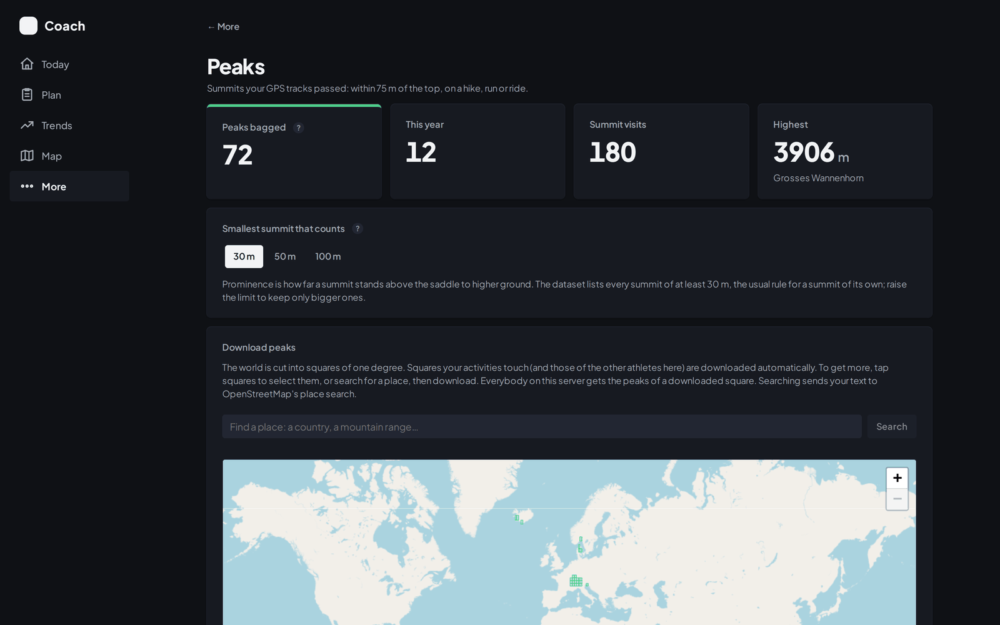

<div align="center">



# Garmin Coach

**A self-hosted training dashboard for your Garmin data, with Claude as your coach.**<br>
TrainingPeaks-style metrics, a season plan to race day, a 3D heatmap of everywhere you've been,
and every summit you've ever stood on. It runs on your own machine.

[](https://github.com/eliashauksson/garmin-claude-coach/releases/latest)


[](LICENSE)

[Features](#features) · [Install](#install) · [User guide](docs/user-guide.html) · [Server setup](docs/server.md) · [Development](docs/development.md)

<br>

&nbsp;


</div>

## Why

- 🧠 **A coach that thinks, and asks first.** Claude drafts your season, plans your weeks and
  adapts them to how you slept, how you felt and what you actually did. Nothing changes until you
  press *Accept*.
- 🔒 **Your data, on your disk.** Garmin data syncs into a local SQLite database. Sync only reads:
  nothing goes back to Garmin until you press *Send to device*.
- ⚡ **One-line install.** No dev tools, no admin rights, no account to make. Windows, Linux, or a
  €5 server you open from your phone.

## Features

### 🤖 An AI coach that plans your season



- **Season plan to race day.** Claude lays out base, specific, taper and race week with weekly
  load targets, cutback weeks and test weeks, and explains why.
- **Always two weeks ahead.** Every Monday the coach plans a new week from your training so far.
  Workouts come with heart-rate, pace or power targets and a block structure.
- **It adapts.** Poor sleep, a niggle, a missed session, *"sick since yesterday"*: the coach
  signals when the plan should change and proposes a re-plan. You accept or reject it.
- **Guard rails in code.** Every week is checked against
  [training principles](training-principles.md): load and recovery, intensity distribution,
  hard-session spacing, long-run progression, heavy leg days before key sessions. Anything off
  shows up as a warning next to the plan.
- **Send to device.** One button puts a planned workout on your Garmin watch or COROS schedule,
  steps and targets included.
- **Cost you can see.** Every Claude request is logged with tokens and cost. Background work
  goes through the half-price Batches API, and you pick model and effort per task.



### 💚 Know if you're ready, every morning

- Training readiness, sleep, overnight HRV, resting heart rate and Body Battery on one page, each
  with its history a tap away.
- When Garmin doesn't give a readiness score, the app **rebuilds it from the raw data**: six
  factors, fitted to your own Garmin scores.
- A morning check that turns it into one line: *"Ready for quality work today"* or
  *"move the run to the evening"*.

### 📈 The numbers serious athletes want



- **Fitness, fatigue and form** (CTL / ATL / TSB), ramp rate and a form forecast to race day.
- **TSS, NP and IF** for every activity: power where you have it, heart rate or pace where you don't.
- **Power curve, eFTP and cycling VO₂ max** from your rides.
- **Training load the Garmin way.** A peak-EPOC model fitted to Garmin's own numbers, so rides
  Garmin never saw (from a COROS bike computer) still count.
- Race predictions, endurance score and recovery trends, with every metric explained in the app.

### 🗺️ Everywhere you've been, in 3D



- A **heatmap of every GPS activity**, filtered by time and sport, in five colour schemes.
- **Real 3D terrain** you can tilt and fly through, on satellite, topo or street maps
  (OpenStreetMap, Esri, Tracestrack, OpenTopoMap, CyclOSM, swisstopo and more).
- Zoom all the way out and the map becomes a **globe floating in the real night sky**: stars,
  the Milky Way, the sun and the moon where they are right now.



### ⛰️ Peak bagging for the whole planet



- **11.9 million summits**: every peak on Earth with at least 30 m prominence, from the
  Kirmse / de Ferranti world prominence dataset.
- Your GPS tracks are checked automatically: pass within 75 m of a top and it's **bagged**,
  shown in crimson on the map.
- Names from swisstopo and OpenStreetMap. Choose how prominent a summit has to be to count.

### And also

- 🚴 **COROS rides** merged in next to your Garmin activities, deduplicated.
- 📱 **Installable on your phone** as a web app, over [Tailscale](https://tailscale.com) from your own server.
- 👥 **Several athletes on one server**, each with their own data, logins and dashboard.
- 🌍 **English, German and French** (Swiss style), including everything Claude writes.
- 💾 **Daily backups** and one-click restore.
- 📝 **An athlete document** about you, your goals and your race that you edit by chatting with Claude.

## Install

The installer fetches everything the app needs into one folder, adds a **Garmin Coach** shortcut
and starts it.

**Windows:** download `install-windows.cmd` from the
[latest release](https://github.com/eliashauksson/garmin-claude-coach/releases/latest) and
double-click it (if Windows says it protected your PC: **More info › Run anyway**). Or press Win+R
and paste:
```
powershell -ExecutionPolicy Bypass -c "irm https://raw.githubusercontent.com/eliashauksson/garmin-claude-coach/main/installer/install.ps1 | iex"
```

**Linux:** open a terminal and paste:
```sh
curl -fsSL https://raw.githubusercontent.com/eliashauksson/garmin-claude-coach/main/installer/install.sh | bash
```

Then follow the **Getting started** checklist on the dashboard:
1. Log in to Garmin (Settings › General).
2. Paste a [Claude API key](https://platform.claude.com/), which you need for the coach.
3. Let the first sync run, then load your full history and write your athlete document.

New to all this? The [step-by-step user guide](docs/user-guide.html) covers installing, costs and
backups. Day-to-day use, file locations and fixes for common problems are in
[docs/troubleshooting.md](docs/troubleshooting.md).

### 📱 On your phone, always on

Run it on a small always-on server (a ~€5/month VPS or a Raspberry Pi) and it syncs every two hours
whether your laptop is on or not. One script sets everything up. The app is never on the open
internet: [Tailscale](https://tailscale.com) gives your own devices a private HTTPS address you can
add to your home screen.
```sh
curl -fsSL https://raw.githubusercontent.com/eliashauksson/garmin-claude-coach/main/installer/server-setup.sh \
  | sudo bash -s -- --timezone Europe/Zurich
```
Full guide, including more athletes: [docs/server.md](docs/server.md).

## Privacy

| Goes out | Why |
|---|---|
| Garmin Connect / COROS | reading your data, and writing a workout only when you press *Send to device* |
| Claude API | the coach: training summaries, your athlete document and plans |
| Map tile servers | the map area you look at |
| GitHub, Overpass, Nominatim | the peak dataset blocks, summit names and place search |

Your GPS tracks, health data and plans **never leave your machine** except as summaries sent to
Claude. The app listens only on `127.0.0.1`.

## Built with

[Clojure](https://clojure.org) 1.12 (reitit, ring, next.jdbc, malli) · [SQLite](https://sqlite.org) ·
[ClojureScript](https://clojurescript.org) with shadow-cljs and [Replicant](https://github.com/cjohansen/replicant) ·
[ECharts](https://echarts.apache.org) · [Leaflet](https://leafletjs.com) · [MapLibre GL](https://maplibre.org) ·
[anthropic-java](https://github.com/anthropics/anthropic-sdk-java) · [garmin_mcp](https://github.com/Taxuspt/garmin_mcp) ·
COROS's official MCP server · the Garmin FIT SDK

To hack on it: `npm install && npm run release && make run`. See
[docs/development.md](docs/development.md) for the commands, how the data and planning work, and
how to make a release.

## Credits

Summits from Andrew Kirmse and Jonathan de Ferranti's world prominence dataset; names from
[swisstopo](https://www.swisstopo.admin.ch) swissNAMES3D and [OpenStreetMap](https://www.openstreetmap.org)
contributors. Terrain by [Mapterhorn](https://mapterhorn.com), satellite imagery by Esri, stars from the
Yale Bright Star Catalogue, Milky Way by ESO/S. Brunier. Garmin and COROS are trademarks of their
owners; this project is not affiliated with either.

## License

The code is [MIT](LICENSE). Map tiles, the summit dataset and place names keep their own licences
and terms.
